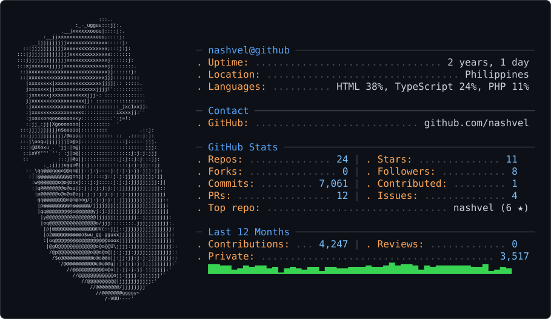

<picture>
  <source media="(prefers-color-scheme: dark)" srcset="dark_mode.svg" />
  <source media="(prefers-color-scheme: light)" srcset="light_mode.svg" />
  
</picture>

<div align="center">

# [NASHVEL](https://nashvel.com)

**Software Engineer · Backend Developer**

Building scalable, reliable, and maintainable software.

[](https://nashvel.com)
[](mailto:nash.backup21@gmail.com)
[](https://x.com/NNasidk)
[](https://stackoverflow.com/users/27668804)

</div>

---

## About Me

I'm a software engineer with a strong focus on backend development,
system architecture, and performance engineering.

I enjoy understanding how systems work beneath the surface,
solving complex technical problems, and designing software
that is reliable, secure, and easy to maintain.

- Backend development and API architecture
- System design and software architecture
- Cross-platform application development
- Performance optimization and debugging
- Open-source development
- Artificial intelligence and agentic systems

> Simplicity is a result of understanding complexity.

---

## Technical Stack

### Backend & Languages


### Frontend


### Cross-Platform Development


### Infrastructure & Database


---

## Engineering Principles

```typescript
const engineer = {
  name: "Nashvel",
  website: "https://nashvel.com",
  focus: "Backend & Systems Engineering",

  principles: [
    "Understand before implementing",
    "Favor simplicity over unnecessary complexity",
    "Fix root causes, not symptoms",
    "Security by design",
    "Measure before optimizing",
    "Keep systems maintainable"
  ],

  mindset: "Continuous learning and improvement"
};
```

---

## Areas of Interest

| Domain | Focus |
| :--- | :--- |
| Software Architecture | Modular and maintainable systems |
| Backend Engineering | APIs, business logic, and data integrity |
| Performance Engineering | Caching, profiling, and optimization |
| Application Security | Authentication, authorization, and secure design |
| Cross-Platform Systems | Web, desktop, and mobile applications |
| Artificial Intelligence | AI agents, automation, and applied research |
| Open Source | Developer tools and collaborative engineering |

---

## GitHub Activity

<div align="center">


</div>

---

## Connect

I'm open to technical discussions, open-source collaboration,
and opportunities to build meaningful software.

Visit my personal website at **[nashvel.com](https://nashvel.com)**
to learn more about me and my work.

<div align="center">

[](https://nashvel.com)
[](https://facebook.com/github.nacht)
[](https://instagram.com/_nashidk)
[](https://pinterest.com/nachtlevh)
[](https://tiktok.com/@dev.nashvel)

</div>

---

## Support My Work

If you find my projects useful, consider supporting
my open-source work.

<div align="center">

[](https://buymeacoffee.com/nashvel)
[](https://paypal.me/LotisQuiblat)
[](https://ko-fi.com/nashvel)

</div>

---

<div align="center">

<sub>Engineering with purpose. Building with precision.</sub>

<br />

<a href="https://nashvel.com">nashvel.com</a>

<br /><br />


</div>
